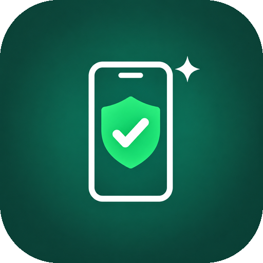

<p align="center">
  
</p>

<h1 align="center">Codex 安卓助手</h1>

<p align="center"><b>一句话配置，让 Codex 帮你操作安卓手机。<br>只能操作你勾选的应用，限时授权，随时一键停止。</b></p>

<p align="center">
  <a href="https://github.com/IamV123/codex-android-control/releases/latest"></a>
  
  
  
  <a href="LICENSE"></a>
</p>

<p align="center">
  <a href="#最简单的用法3-步">快速开始</a> ·
  <a href="https://github.com/IamV123/codex-android-control/releases/latest/download/codex-android-control.apk">下载手机 App</a> ·
  <a href="#遇到问题怎么办">遇到问题</a> ·
  <a href="#授权规则">安全说明</a>
</p>

## 它能做什么

| | |
| --- | --- |
| 📱 **替你动手** | 打开 App、点按、输入、上下滑动、返回。比如“打开抖音刷 5 个视频，每个停 2–5 秒”“在微博搜索杭州小吃，打开第二条”。 |
| 🔒 **只碰你允许的** | 你在手机上勾选了哪些应用，就只能操作哪些；没勾选的既读不到、也点不了。默认一个都不授权。 |
| ⏱️ **限时、随时停** | 授权默认 1 天，到期自动结束。在 App、通知栏或电脑网页上都能一键停止；锁屏时自动暂停。 |
| 🔐 **加密直连** | 手机只和你自己的电脑通信，内容端到端加密。不用 VPN，不用连同一个 Wi-Fi，也不用 root 或 ADB。 |
| 🤖 **一句话配置** | 对 Codex 说一句话，电脑端自动装好；手机装好 App 后扫码就能用。 |

> 这是**实验测试版**。默认使用 Cloudflare 临时通道，电脑端重启后要在手机上重新扫码。操作时手机要保持解锁，电脑和手机都要联网。

## 最简单的用法（3 步）

**你需要**：一台 Windows 10/11 电脑，装好并登录了 Codex；一部 Android 13 或更新的手机，设置了锁屏密码。

**第 1 步 · 电脑**：把下面这句话发给 Codex。

> 按 https://github.com/IamV123/codex-android-control 配置

Codex 运行命令时会请求权限，点同意。几分钟后，电脑会自动打开配对网页 `http://127.0.0.1:18765/`（每台电脑都是这个地址，只能在本机打开），同时会有一个黑色窗口，**别关它**。然后**完全退出 Codex（包括右下角托盘图标），再重新打开**。

**第 2 步 · 手机**：用手机相机扫配对网页上的“**下载手机 App**”二维码，下载并安装 App。打开 App：

1. 点 **开启通知** → 允许。
2. 点 **开启无障碍服务**，找到“Codex 安卓助手（手动授权）”，打开开关。
3. **开关是灰色、弹出“受限设置”**（大多数手机都会这样）：点“确定” → 回到桌面，长按 Codex 安卓助手图标 → **应用信息** → 右上角 **⋮** → **允许受限制的设置** → 验证锁屏密码 → 再回到第 2 步打开开关。

**第 3 步 · 连接**：用手机相机扫配对网页上的“**配对二维码**”，选择用 Codex 安卓助手打开。勾选允许操作的应用，点 **确认并开始**，验证锁屏密码。看到 **已连接电脑** 就完成了。

**然后就可以用了**：在 Codex 里新建一个任务，直接说要做什么，例如：

- “用手机打开抖音，刷 5 个视频，每个停 2 到 5 秒。”
- “打开快手，进入当前视频作者的主页，打开他的第一个视频。”
- “打开微博，搜索 杭州小吃，打开第二条结果。”

**以后每次使用**：双击桌面上的“**启动 Codex 手机助手**”，手机重新扫一次配对二维码。

卡住了？看[遇到问题怎么办](#遇到问题怎么办)，或者照[详细教程](#详细教程手动安装或出问题时对照)一步一步对照。

## 给 Codex 的配置说明

> 用户让你“按本仓库配置”时，照下面做。不需要你操作手机。

1. 在 PowerShell 中运行下面 4 行。需要联网，会写入 `%USERPROFILE%\CodexAndroidControl` 和 `%USERPROFILE%\.codex\config.toml`，还会在桌面创建快捷方式。
   - 沙盒拦截网络（例如报“不知道这样的主机”）、重定向 TEMP，或不能写用户目录时：申请提升权限（escalated），然后**原样**重新运行这 4 行。
   - 不要改安装目录，也不要换下载地址或镜像。

   ```powershell
   $f = Join-Path $env:TEMP 'cac-install.ps1'
   [Net.ServicePointManager]::SecurityProtocol = [Net.SecurityProtocolType]::Tls12
   Invoke-WebRequest -UseBasicParsing 'https://github.com/IamV123/codex-android-control/releases/latest/download/install.ps1' -OutFile $f
   powershell -NoProfile -ExecutionPolicy Bypass -File $f
   ```

2. 安装大约需要 2–6 分钟，脚本会一直等到手机通道真正就绪才结束。npm 输出的 `npm warn Unknown user config` 之类警告不影响安装，不用处理。看到“安装完成，电脑端已就绪”后，把输出里“接下来”那几条**原样**告诉用户。
3. 安装会打开一个电脑端窗口，**不要关闭它**。也不要把配对码或二维码内容发到聊天里。
4. 出错时，把错误原文告诉用户，并对照本页“遇到问题怎么办”。重新运行同样的命令是安全的，相当于升级或重装。
5. 用户重新打开 Codex 后，手机工具名都以 `phone_` 开头，直接调用即可，不要写脚本。

## 详细教程（手动安装，或出问题时对照）

不想用 Codex 自动配置，或者自动配置出了问题，就照下面一步一步做。每一步都写了“做对了会看到什么”；看到的不一样，就去[遇到问题怎么办](#遇到问题怎么办)查。

- 手机 App：[codex-android-control.apk](https://github.com/IamV123/codex-android-control/releases/latest/download/codex-android-control.apk)
- 电脑端：[最新版本页面](https://github.com/IamV123/codex-android-control/releases/latest)，下载名字以 `-desktop.zip` 结尾的文件

### 0. 先确认你有这些

- 一台 **Windows 10 或 Windows 11** 电脑，已经装好 **Codex** 并登录。
- 一部 **Android 13 或更新** 的手机。查看方法：手机“设置 → 关于手机”，找“Android 版本”。纯血鸿蒙（HarmonyOS NEXT）不能安装 APK，用不了。
- 手机已经设置了 **锁屏密码**（数字、图案或密码都行）。没设的话：手机“设置 → 安全/密码与安全 → 锁屏密码”先设一个。
- 电脑和手机都能上网。**不需要连同一个 Wi-Fi，不需要 VPN。**

### 1. 电脑：Node.js（一般可以跳过）

电脑上没有 Node.js 时，第 4 步的 `Start-Desktop.cmd` 会自动下载一个免安装版，放在电脑端文件夹里，不需要管理员权限。所以这一步一般可以跳过。

想自己装也可以：打开 <https://nodejs.org>，下载带 **LTS** 字样的 Windows 安装包（`.msi`），一路点 **Next → Install → Finish**。

### 2. 电脑：下载并解压电脑端（只做一次）

1. 打开[最新版本页面](https://github.com/IamV123/codex-android-control/releases/latest)，下载名字以 `-desktop.zip` 结尾的文件。浏览器提示“不常下载”时，选“保留”。
2. 找到下载好的 zip 文件，**右键 → 全部解压缩**，解压到一个固定的位置，例如 `D:\CodexAndroid`。
   - 一定要先解压，**不要在 zip 里面直接双击运行**。
   - 文件夹路径里不要有英文单引号 `'`。
   - 解压后不要再移动这个文件夹。如果移动了，要重新做第 3 步。
3. **做对了**：打开解压后的文件夹，能看到 `Start-Desktop`、`Connect-Codex`、`src` 等文件。电脑如果不显示扩展名，`Start-Desktop.cmd` 会显示成 `Start-Desktop`，类型是“Windows 命令脚本”，这是正常的。

### 3. 电脑：把手机工具接入 Codex（只做一次）

1. 在解压后的文件夹里双击 **`Connect-Codex.cmd`**（不是 `.ps1`，`.ps1` 双击只会用记事本打开）。
   - 弹出“Windows 已保护你的电脑”：点 **更多信息 → 仍要运行**。
   - 弹出“是否要运行此文件”：点 **运行**。
2. **做对了**：黑色窗口显示 `完成：已把手机工具加入 Codex。请完全退出 Codex（包括右下角托盘图标）后重新打开。`（如果显示 `已配置过，无需重复运行。` 也是对的）。按任意键关闭窗口。
3. **完全退出 Codex**：关掉 Codex 窗口，再到屏幕右下角托盘（时间旁边的 `^`）找到 Codex 图标，右键退出。然后重新打开 Codex。

### 4. 电脑：启动电脑端（每次开电脑后都要做）

1. 双击 **`Start-Desktop.cmd`**。第一次运行会自动下载需要的组件，可能要几分钟，窗口里滚动文字是正常的。
2. 窗口显示 `正在连接手机通道，约需 1–3 分钟，请不要关闭此窗口…`，耐心等。
3. **做对了**：窗口显示 `已就绪：配对网页 http://127.0.0.1:18765/ …`，浏览器自动打开“Codex 安卓助手”网页，上面有两个二维码：**配对二维码**（手机 App 装好后扫这个）和 **下载手机 App** 的二维码，还有一段配对码和一行“连接地址：https://….trycloudflare.com”。浏览器没自动打开，就自己在浏览器地址栏输入 `http://127.0.0.1:18765/`。
4. **这个黑色窗口一直开着，不要关**。关了手机就断开。使用期间也不要让电脑睡眠（“设置 → 系统 → 电源”里把睡眠改成“从不”）。
5. 网页上的“新配对有效期”默认 **1 天**，一般不用改。
6. **配对码和二维码等于密码**，不要截图发给别人，不要发到群里。

### 5. 手机：安装 App（只做一次）

1. 用手机相机扫配对网页上的“下载手机 App”二维码；或者在手机浏览器打开 [codex-android-control.apk](https://github.com/IamV123/codex-android-control/releases/latest/download/codex-android-control.apk) 下载。
   - 手机打不开 GitHub：在电脑上下载这个 APK，用数据线连上手机（手机上选“传输文件”），把 APK 复制到手机的“Download/下载”文件夹，再用手机“文件管理”打开它。
   - 不建议用微信传 APK，微信里经常打不开安装包。
2. 点下载好的文件开始安装。
   - 提示“禁止安装未知来源应用”：点“设置”，打开“允许来自此来源的应用”，返回继续安装。
   - 小米、OPPO、vivo、华为等提示“风险应用”、要求扫描或登录账号：选 **继续安装 / 仍然安装**。华为/荣耀如果开着“纯净模式”，需要按提示允许安装。
3. **做对了**：桌面出现“Codex 安卓助手”图标。

### 6. 手机：App 里的准备工作（只做一次）

1. 打开“Codex 安卓助手”。
2. 点 **开启通知**，在弹窗里点 **允许**。
3. 点 **开启无障碍服务**，会跳到系统的无障碍设置页面。
   1. 在“已下载的应用 / 已安装的服务”里找到 **Codex 安卓助手（手动授权）**，点进去，打开开关。
   2. 弹出“允许……完全控制您的设备吗”之类的提示：点 **允许 / 确定**。有的手机要等几秒倒计时才能点。
   3. **开关是灰色的，或提示“受限设置”**（Android 13 及以后自己安装的 App 常见）：先在提示框点“确定”，回到手机桌面，**长按 Codex 安卓助手图标 → 应用信息**，点右上角 **⋮**（三个点），选 **允许受限制的设置**，验证锁屏密码；然后再回到无障碍设置打开开关。不同品牌的菜单位置可能略有不同，在“应用信息”页面里找“允许受限制的设置”。
4. 回到“Codex 安卓助手”。
5. 建议：手机“设置 → 应用 → Codex 安卓助手 → 电池/耗电管理”里选 **无限制 / 允许后台运行**，否则用着用着可能被系统关掉。

### 7. 手机：配对并开始（每次电脑端重新启动后都要做）

1. **扫码**：用手机 **系统相机** 或 **系统自带的“扫一扫”** 扫电脑网页上的 **配对二维码**（不是“下载手机 App”那个），点识别出来的链接，选择用 **Codex 安卓助手** 打开。配对码会自动填进 App 的“电脑配对码”框里。
   - **不要用微信或支付宝扫一扫**，它们会提示“无法打开”。
   - 扫码后只显示一段文字、没有打开 App：长按复制那一整段以 `codexandroid://pair?data=` 开头的文字，打开 Codex 安卓助手，粘贴到“电脑配对码”框里。
   - 框里如果已经有旧配对码，先把旧的**全部删掉**，再粘贴新的。
2. **勾选应用**：在“未选中的应用”里勾选允许 Codex 操作的应用，例如“抖音”“快手”。可以在搜索框输入名字查找，应用多时用“上一页 / 下一页”翻页。勾选后，这个应用会移到上面的“已选中的应用（N 个）”里。**只有勾选的应用能被操作，没勾选的都不能。**
3. **授权时长**：默认 **1 天**，一般不用改。
4. 点底部 **确认并开始**。弹窗里会显示“连接地址”，看一下和电脑网页上“连接地址：”后面的一样。然后点 **验证身份并开始**，输入锁屏密码或指纹。
5. **做对了**：App 底部显示 **已连接电脑**，通知栏有“Codex · 已连接电脑”；电脑网页的状态变成“配对有效 · 手机已连接”，下面列出你勾选的应用包名（例如 `com.ss.android.ugc.aweme` 就是抖音）。

### 8. 在 Codex 里使用

1. 在 Codex 里 **新建一个任务**，专门用来操作手机。如果能选推理强度，选 **中** 或 **低**，反应更快。
2. 保持手机 **亮屏、解锁**。锁屏时会暂停操作，解锁后继续。
3. 直接用中文说要做什么，例如：
   - “用手机工具打开抖音，往下刷 5 个视频，每个停留 2 到 5 秒。”
   - “打开快手，进入当前视频作者的主页，打开他的第一个视频。”
   - “打开微博，搜索 杭州小吃，打开第二条结果。”
4. 用完后：在 App 底部点 **立即停止**，或者下拉通知栏点 **立即停止**；也可以在电脑网页点 **立即撤销**。

### 以后每次使用

- **电脑一直开着、只是手机断网**：网络恢复后会自动重连，不用重新扫码。
- **电脑重启过，或者关掉过黑色窗口**：
  1. 双击桌面上的“**启动 Codex 手机助手**”（这是让 Codex 自动配置时创建的；手动安装的就双击 `Start-Desktop.cmd`），等网页打开。
  2. 手机打开 Codex 安卓助手。如果底部还显示在连接，先点 **立即停止**。
  3. 删掉框里的旧配对码，重新扫网页上新的 **配对二维码**（第 7 步）。勾选的应用会保留，直接点 **确认并开始**。
- 想让电脑开机后自动启动电脑端，可以双击 `Enable-AutoStart.cmd`（取消用 `Disable-AutoStart.cmd`）。自动启动时没有黑色窗口，需要自己在浏览器打开 `http://127.0.0.1:18765/`，手机仍然要扫新的二维码。

## 遇到问题怎么办

| 你看到的 | 怎么办 |
| --- | --- |
| 让 Codex 配置时，它说没有权限联网或不能写文件 | 在 Codex 弹出的权限请求里点同意；没有弹窗就跟它说“允许联网并写入用户目录，重新运行安装命令”。 |
| 安装命令报错，提示下载失败 | 网络不稳定，无法访问 GitHub。换个网络（例如手机热点）后，让 Codex 重新运行同样的命令。 |
| 提示 Node.js 下载失败 | 网络问题。重新运行一次；还不行就按第 1 步自己装 Node.js，再重新运行。 |
| 双击后打开的是记事本 | 你双击的是 `.ps1` 文件。请双击同名的 `.cmd` 文件。 |
| 提示“依赖安装失败” | 检查电脑网络，再双击一次 `Start-Desktop.cmd`（程序会自动换国内镜像再试一次）。 |
| 提示“通道程序下载校验失败”或下载报错 | 电脑下载组件时网络不稳定。换个网络（例如手机热点）后再双击一次 `Start-Desktop.cmd`。 |
| 黑色窗口反复显示“连接中断，N 秒后自动重试…”超过 5 分钟 | 电脑连不上 Cloudflare。检查网络，或换一个网络后关掉窗口、重新双击 `Start-Desktop.cmd`。 |
| 窗口显示“已就绪”，但浏览器没打开 | 自己在浏览器输入 `http://127.0.0.1:18765/`。 |
| 网页显示“无法读取电脑状态，请刷新页面” | 按 F5 刷新。黑色窗口被关掉了的话，重新双击 `Start-Desktop.cmd`。 |
| 微信 / 支付宝扫码显示“无法打开” | 改用手机系统相机或系统“扫一扫”；或者复制 `codexandroid://pair?data=` 开头的整段文字，粘贴到 App 里。 |
| 手机提示“请粘贴完整配对码”或“配对码缺少数据” | 文字没复制全。删掉重新扫码，或在电脑网页点“复制配对码”后重新完整粘贴。 |
| 手机提示“连接失败：配对已失效，请在电脑重新配对后复制新配对码” | 用的是旧码，或者电脑端重启过。删掉框里的旧码，刷新电脑网页，重新扫码。 |
| 手机提示“电脑配对已到期，或手机时间不正确，请重新配对” | 打开手机“设置 → 日期和时间 → 自动设置”；然后在电脑网页点“重新配对并使用此时长”，再扫新码。 |
| 手机提示“请先停止当前会话。” | 先点底部 **立即停止**，再点 **确认并开始**。 |
| 手机提示“请先在无障碍设置中启用…” | 做第 6 步第 3 小步。开关是灰色的，看“受限设置”那一段。 |
| 手机提示“请先允许通知…” | 点 App 里的“开启通知”，或在手机“设置 → 通知”里允许 Codex 安卓助手。 |
| 手机提示“请先设置锁屏密码…” | 在手机设置里设一个锁屏密码（第 0 步）。 |
| 手机提示“请勾选1至500个允许使用的应用” | 至少勾选一个应用。 |
| 手机提示“连接超时”“手机无法解析连接地址”“网络连接中断” | 检查手机网络（Wi-Fi 和流量换着试）。确认电脑黑色窗口还开着、电脑没睡眠。然后点“立即停止”，重新扫码开始。 |
| 手机提示“手机无法建立安全连接，请检查网络和系统时间” | 打开手机“自动设置日期和时间”，换个网络再试。 |
| 手机底部显示“网络中断，等待电脑恢复连接” | 电脑端断开了。电脑黑色窗口还开着就等一会儿，会自动恢复；窗口被关掉或电脑重启过，就按“以后每次使用”重新开始。 |
| 用着用着 App 显示已停止 | 可能被系统清理了后台，或者授权到期了。按第 6 步第 5 小步设置电池“无限制”，再重新点“确认并开始”。 |
| 安装 APK 时提示“签名不一致”“与已安装的应用冲突” | 手机上装过别处来的同名 App。先卸载旧的 Codex 安卓助手，再安装。 |
| Codex 说没有手机工具，或找不到 `phone_` 开头的工具 | 重新双击 `Connect-Codex.cmd`，然后完全退出 Codex（包括托盘图标）再打开，新建一个任务。 |
| Codex 说 `phone_not_connected`（手机未连接） | 看手机 App 底部是否显示“已连接电脑”。没有的话，重新做第 7 步。 |
| Codex 说 `app_not_authorized`（应用未授权） | 这个应用没勾选。在手机 App 里勾选它（改勾选会停止当前授权），再点“确认并开始”。 |
| Codex 说 `phone_locked`（手机已锁屏） | 解锁手机，保持亮屏。 |
| Codex 说 `phone_authorization_expired` 或 `session_ended` | 授权到期或已停止。在手机上重新点“确认并开始”。 |
| 电脑网页出现“已核对手机，解除未确认操作阻塞”按钮 | 上一个操作没有收到结果。先看手机上那个操作到底做了没有，再点这个按钮，然后让 Codex 继续。 |

## 授权规则

| 手机状态 | Codex 可以做什么 |
| --- | --- |
| 未开启会话、已锁屏或已过期 | 只能查看电脑侧连接状态 |
| 前台应用未勾选 | 不读取、不点击、不输入、不滚动或滑动，不执行返回或回桌面 |
| 应用已勾选 | 打开应用；在其前台页面读取、点击、输入、滚动、手势滑动、返回、回桌面 |
| 更改勾选、停止会话、停用无障碍或电脑撤销 | 原会话终止，需要重新本机授权；有效配对码可复用 |

应用必须由手机上的人勾选，电脑没有增加授权的接口。手机授权与电脑配对均可自选分钟、小时或天，最长30天，以先到期者为准。开启会话时核对电脑地址并验证一次手机身份；会话内操作不再逐次确认。

小红书、微信、快手、抖音、淘宝和其他可启动应用均可选择。助手本身、系统设置、权限管理、安装器和已识别的安全中心不在可选列表。前台切换到其他应用或系统窗口时，原节点不可继续操作。能否读到和操作某个按钮取决于应用是否提供 Android 无障碍节点。

## 升级与进阶说明

第一次安装请看上面的[最简单的用法](#最简单的用法3-步)。下面是升级和进阶用法。

- **手机升级**：下载新版 APK 直接覆盖安装，不用卸载。装完检查无障碍服务仍是打开的，然后重新扫码点“确认并开始”。
- **电脑升级**：先在手机点“立即停止”，关掉电脑端黑色窗口，把新版 zip 解压覆盖到原来的文件夹（保留里面的 `.runtime` 文件夹），再双击 `Start-Desktop.cmd`。文件夹位置没变就不用重新运行 `Connect-Codex.cmd`。
- **开机自动启动**：`Enable-AutoStart.cmd` 只给当前 Windows 用户添加一个登录启动项，不设置自动登录，也不修改其他启动项；撤销用 `Disable-AutoStart.cmd`。默认临时通道重启后地址改变，手机仍需用新配对码重新连接。
- **手机重启或连接服务被系统结束**：需要在手机上重新点“确认并开始”；没有手机开机自动授权。

更新电脑端时先确认没有未完成操作并停止原进程，替换新版源文件；保留原Codex配置和 `.runtime` 私有目录。不要在已发出操作且尚无回执时强行更新。不要将配对码或二维码发到聊天或公开截图。

电脑与手机不必使用同一Wi-Fi。默认使用 Cloudflare Quick Tunnel 临时通道：每次启动获得随机 HTTPS 地址，电脑或电脑端程序重启后地址改变，手机需用新配对码重新连接。设 `CAC_TUNNEL_PROVIDER=localtunnel` 回到固定名字通道：每台安装保留随机固定名字与已验证的中继分配，重启先接回原通道，原分配失效后只申请同名地址；该免费服务不保证名字可用性或保留权。手机到通道使用HTTPS，电脑到通道使用TCP，正文另用端到端加密。正式固定入口可设置 `CAC_PUBLIC_ORIGIN` 并只代理手机端口 `127.0.0.1:18766`；管理端口18765与后台防重复启动端口18764不可暴露。

电脑端暂时关闭、关机或断网会暂停连接，原授权继续计时；要撤销请用手机停止或电脑网页“立即撤销”。进程仍在运行时网络恢复，手机会自动重连，不会重新执行中断时结果未知的操作。电脑端重启后临时通道地址已变，需刷新配对页并在手机上用新配对码重新本机授权。移除 MCP：用记事本打开 `%USERPROFILE%\.codex\config.toml`，删除 `[mcp_servers.android_control]` 这一段（到下一个 `[` 开头的行之前），保存后重开 Codex；不影响其他 MCP。`Connect-Codex.cmd` 写入前的备份在电脑端文件夹的 `.runtime\config-backups` 里。

## 数据与权限

- 授权应用里的按钮没有页面关键词限制，执行什么操作仍由用户的具体任务决定。应用选择是本项目的运行时校验，不是 Android 为无障碍服务提供的独立应用沙箱，也不是绝对安全保证。
- 已授权页面的文字会到达电脑和所用 AI 服务；系统标记的密码或敏感节点文字被省略，但无法保证识别全部隐私。
- 手机只主动连接 HTTPS，不开监听端口、不占用 VPN。HKDF-SHA256 派生认证及加密密钥，AES-256-GCM 绑定会话、方向和递增序号；拒绝篡改和重放。
- 手机授权与密钥仅保存在连接服务内存。断线保持剩余授权并重连，锁屏暂停控制；停止或服务被结束后不自动授权。电脑配对信息与恢复日志由当前Windows用户DPAPI加密保存；本地管理状态文件仍包含管理密钥，目录ACL限制访问。
- 不包含截图、录屏、通知读取、剪贴板、文件浏览、相机、麦克风、任意坐标点击、Shell、ADB 或系统设置写入接口。
- 公共中继能观察部分连接元数据和派生的传输凭据；加密内容与配对主密钥的边界见 [SECURITY.md](SECURITY.md)。

## 版本记录

每个版本改了什么，见 [CHANGELOG.md](CHANGELOG.md)；下载见 [Releases](https://github.com/IamV123/codex-android-control/releases)。

## 构建与验证

工具链：JDK 17、Android SDK Platform 36、Build Tools 36.0.0、Gradle 9.1.0、AGP 9.0.0。

```powershell
cd desktop
npm ci --ignore-scripts
npm test
cd ..
node tools/test-cross-crypto.mjs
.\gradlew.bat :app:assembleRelease :app:lintRelease
```

未设置签名环境变量时输出 unsigned APK。发布包使用同一项目 release 签名，`debuggable=false`。签名变量为 `CAC_KEYSTORE`、`CAC_STORE_PASSWORD`、`CAC_KEY_PASSWORD`，别名 `release`。密钥不进入源码和发布包。

[验证记录](docs/VALIDATION.md) 区分自动测试、公网模拟和真实手机操作。项目尚未接受独立安全审计。

这是独立实现，设计时参考 [codex-control-android-mcp](https://github.com/miko684/codex-control-android-mcp) 和 [android-use](https://github.com/bsaisuryacharan/android-use) 的公开方案，没有复制其实现。二维码依赖 `qrcode`，可选隧道程序来自 Cloudflare 官方发行版。

MIT License。
